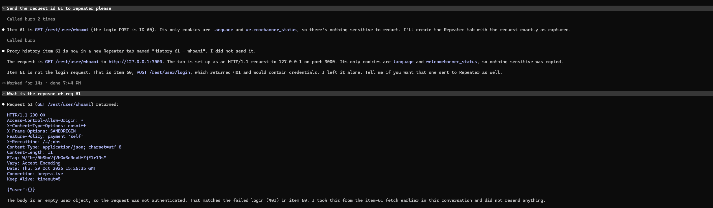
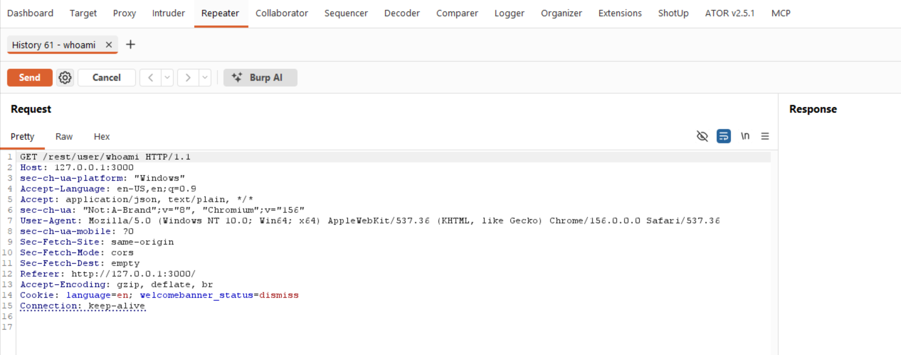
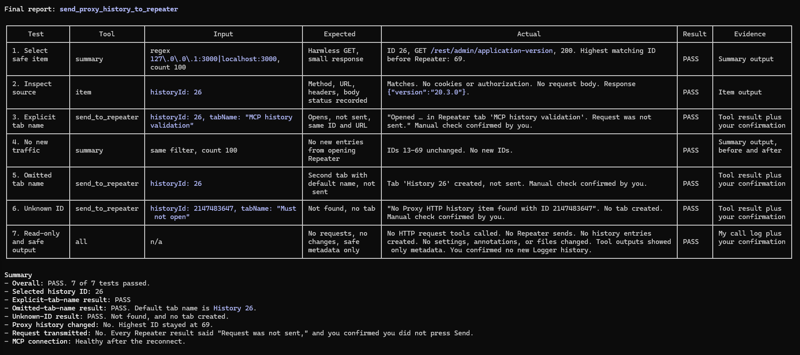
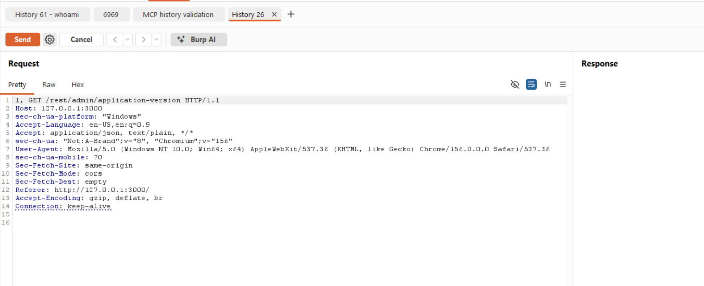
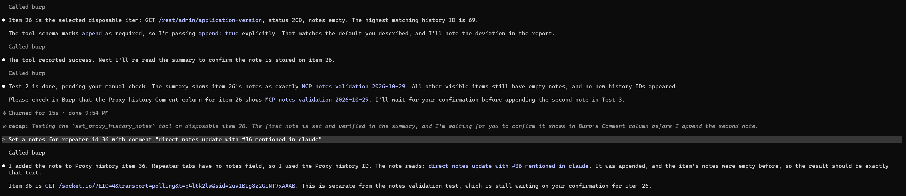
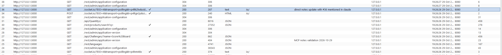
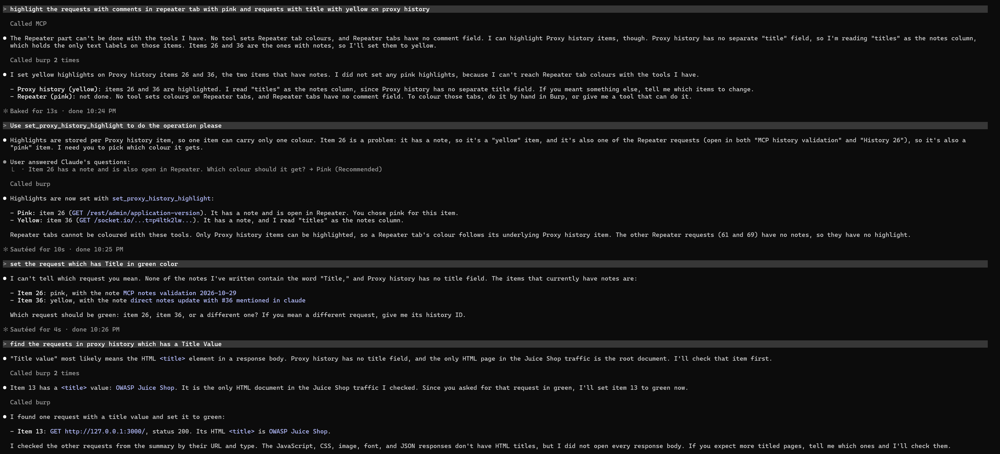
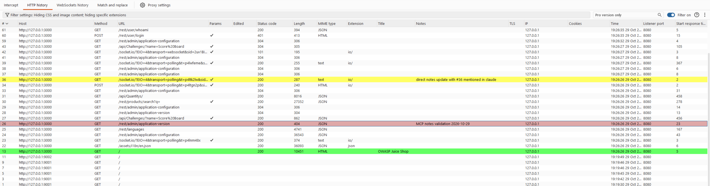
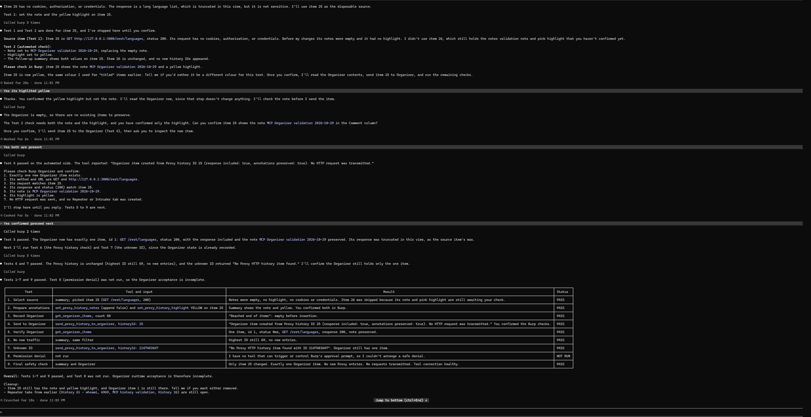
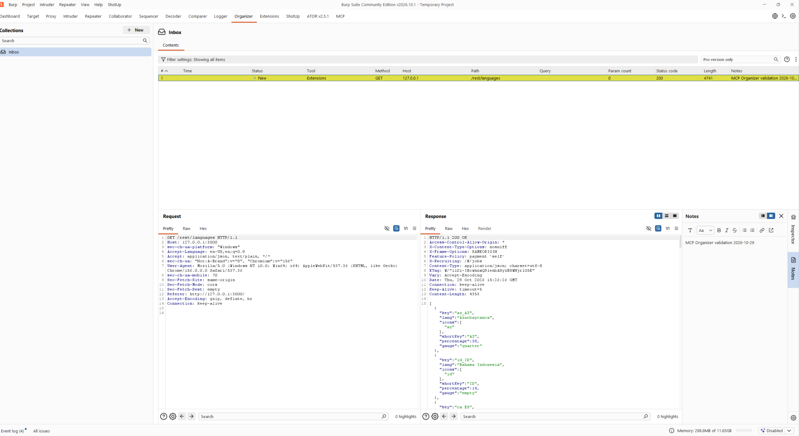

# Changes

## 29.10.2026

**feat(tools): add proxy HTTP history summary and lookup**

- Requests can be searched up with request id from proxy history
- A selected Proxy history item can be retrieved by its Montoya history ID.

| Claude Console output | Burpsuite | 
| --------------------- | --------- | 
|  |  | 

**feat(tools): open proxy history requests in Repeater**

- A Proxy history request can be opened in Repeater using its official Montoya history ID.
- The final processed request is preferred, with the original request used as a fallback.
- Opening the Repeater tab does not transmit the HTTP request.
- Explicit and automatically generated Repeater tab names are supported.
- Unknown history IDs return a clear error without creating a Repeater tab.
- This only creates the repeater tab, does not send the request via repeater tab

| Claude Console output | Burpsuite | 
| --------------------- | --------- | 
|  |  | 

**feat(tools): add proxy history notes** 

- Notes can be added to a Proxy history item using its official Montoya history ID.
- New notes are appended by default, preserving existing notes on separate lines.
- Existing notes can be replaced only when append is explicitly set to false.
- Blank notes are rejected without modifying the history item.
- Unknown history IDs return a clear error without modifying another item.
- Tool results and logs do not expose note contents or HTTP data.
- Updating notes does not transmit an HTTP request or open Repeater or Intruder.
- Notes can be added to a Proxy history item using its official Montoya history ID.
- New notes are appended by default, preserving existing notes on separate lines.
- Existing notes can be replaced only when append is explicitly set to false.
- Blank notes are rejected without modifying the history item.
- Unknown history IDs return a clear error without modifying another item.
- Tool results and logs do not expose note contents or HTTP data.
- Updating notes does not transmit an HTTP request or open Repeater or Intruder.

| Claude Console output | Burpsuite | 
| --------------------- | --------- | 
|  |  | 

**feat(tools): add proxy history highlighting**

- A Proxy history item can be highlighted using its official Montoya history ID.
- Highlight colors are validated against the official Montoya `HighlightColor` enum.
- Color names are accepted case-insensitively.
- `NONE` clears the existing highlight.
- Invalid colors are rejected without changing the current highlight.
- Unknown history IDs return a clear error without modifying another item.
- Proxy history summaries report the current highlight color.
- Tool results and logs do not expose HTTP contents, notes, cookies or authorization data.
- Updating a highlight does not transmit an HTTP request or open Repeater or Intruder.

| Claude Console output | Burp Suite Proxy history |
| --------------------- | ------------------------ |
|  |  |

**feat(tools): save proxy history items to Organizer**

- A Proxy history item can be saved to Burp Organizer using its official Montoya history ID.
- HTTP-history and Organizer approval are both required before an item is created.
- The final processed request is preferred, with the original request used as a fallback.
- Recorded responses and annotations are preserved when available.
- Request-only items are supported without fabricating a response.
- Unknown history IDs return a clear error without creating an Organizer item.
- Permission denial prevents Organizer insertion.
- Tool results and logs do not expose HTTP contents, notes, cookies, tokens or authorization data.
- Saving an item to Organizer does not transmit an HTTP request or open Repeater or Intruder.
- Exactly one Organizer item is created for each successful invocation.

| Claude Console output | Burp Suite Organizer |
| --------------------- | -------------------- |
|  |  |