# Changes

Changes made during each commit - to keep track of the functionality and to plan future implementations.

---
need_to_implement: sending request in repeater, adding markers in intruder operations, list all the tabs in repeater section - mcp created and manually created.

---

## 29.10.2026

**feat(tools): add proxy HTTP history summary and lookup**

- Requests can be searched up with request id from proxy history
- A selected Proxy history item can be retrieved by its Montoya history ID.

| Claude Console output | Burpsuite | 
| --------------------- | --------- | 
|  |  | 

**feat(tools): open proxy history requests in Repeater**

- A Proxy history request can be opened in Repeater using its official Montoya history ID.
- The final processed request is preferred, with the original request used as a fallback.
- Opening the Repeater tab does not transmit the HTTP request.
- Explicit and automatically generated Repeater tab names are supported.
- Unknown history IDs return a clear error without creating a Repeater tab.
- This only creates the repeater tab, does not send the request via repeater tab

| Claude Console output | Burpsuite | 
| --------------------- | --------- | 
|  |  | 

**feat(tools): add proxy history notes** 

- Notes can be added to a Proxy history item using its official Montoya history ID.
- New notes are appended by default, preserving existing notes on separate lines.
- Existing notes can be replaced only when append is explicitly set to false.
- Blank notes are rejected without modifying the history item.
- Unknown history IDs return a clear error without modifying another item.
- Tool results and logs do not expose note contents or HTTP data.
- Updating notes does not transmit an HTTP request or open Repeater or Intruder.
- Notes can be added to a Proxy history item using its official Montoya history ID.
- New notes are appended by default, preserving existing notes on separate lines.
- Existing notes can be replaced only when append is explicitly set to false.
- Blank notes are rejected without modifying the history item.
- Unknown history IDs return a clear error without modifying another item.
- Tool results and logs do not expose note contents or HTTP data.
- Updating notes does not transmit an HTTP request or open Repeater or Intruder.

| Claude Console output | Burpsuite | 
| --------------------- | --------- | 
|  |  | 

**feat(tools): add proxy history highlighting**

- A Proxy history item can be highlighted using its official Montoya history ID.
- Highlight colors are validated against the official Montoya `HighlightColor` enum.
- Color names are accepted case-insensitively.
- `NONE` clears the existing highlight.
- Invalid colors are rejected without changing the current highlight.
- Unknown history IDs return a clear error without modifying another item.
- Proxy history summaries report the current highlight color.
- Tool results and logs do not expose HTTP contents, notes, cookies or authorization data.
- Updating a highlight does not transmit an HTTP request or open Repeater or Intruder.

| Claude Console output | Burp Suite Proxy history |
| --------------------- | ------------------------ |
|  |  |

**feat(tools): save proxy history items to Organizer**

- A Proxy history item can be saved to Burp Organizer using its official Montoya history ID.
- HTTP-history and Organizer approval are both required before an item is created.
- The final processed request is preferred, with the original request used as a fallback.
- Recorded responses and annotations are preserved when available.
- Request-only items are supported without fabricating a response.
- Unknown history IDs return a clear error without creating an Organizer item.
- Permission denial prevents Organizer insertion.
- Tool results and logs do not expose HTTP contents, notes, cookies, tokens or authorization data.
- Saving an item to Organizer does not transmit an HTTP request or open Repeater or Intruder.
- Exactly one Organizer item is created for each successful invocation.

| Claude Console output | Burp Suite Organizer |
| --------------------- | -------------------- |
|  |  |

**feat(tools): add Organizer summary and item lookup**

- Compact Organizer item summaries can be retrieved without exposing complete HTTP requests or responses.
- Summaries include the official Montoya Organizer ID, status, method, URL, response status, notes, highlight color and response availability.
- Organizer summaries support optional Java regular-expression filtering.
- Regex filtering is applied before pagination.
- Organizer items can be retrieved individually using their official Montoya Organizer ID.
- Unknown Organizer IDs return a clear error without returning a different item.
- Invalid regular expressions return a controlled error without disconnecting the MCP client.
- Large request or response fields may be truncated by the existing shared serializer.
- Both tools require Organizer access approval.
- Both tools are read-only and do not modify Organizer items, annotations or statuses.
- Retrieving Organizer data does not transmit an HTTP request or open Repeater or Intruder.

| Claude Console output | Burp Suite Organizer |
| --------------------- | -------------------- |
| 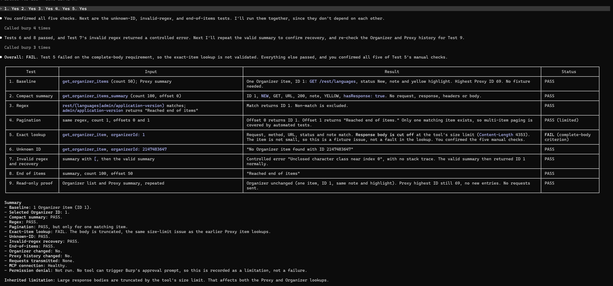 | 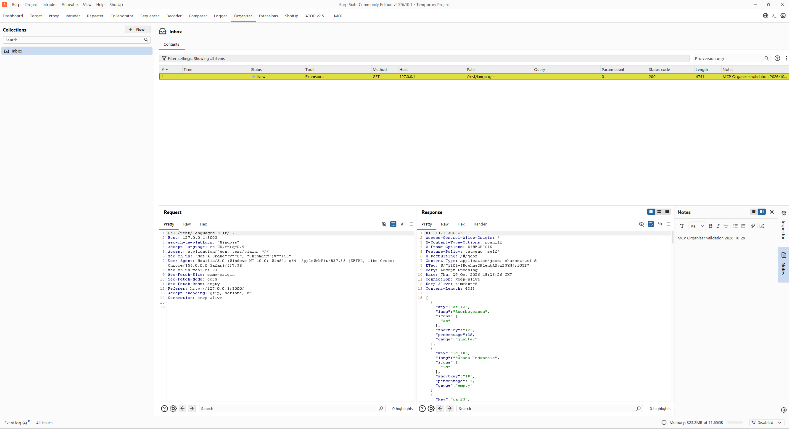 |

## 30.10.2026

**feat(tools): open Organizer requests in Repeater**

- A request saved in Burp Organizer can be opened in Repeater using its official Montoya Organizer ID.
- Organizer access approval is required before an item is read or opened.
- The original Organizer request is transferred directly through Montoya without serialization or reconstruction.
- Explicit Repeater tab names are supported and passed unchanged.
- Omitted or blank tab names use the default `Organizer <organizerId>` format.
- Unknown Organizer IDs return a clear error without creating a Repeater tab.
- Missing requests return a controlled error without opening Repeater.
- Tool results and logs do not expose HTTP contents, notes, cookies, tokens or authorization data.
- Opening the request in Repeater does not transmit the HTTP request.
- The source Organizer item, its annotations and its status remain unchanged.
- The Organizer response is not transferred; the Repeater response pane remains empty until the request is manually sent.

| Claude Console output | Burp Suite Repeater |
| --------------------- | ------------------- |
| 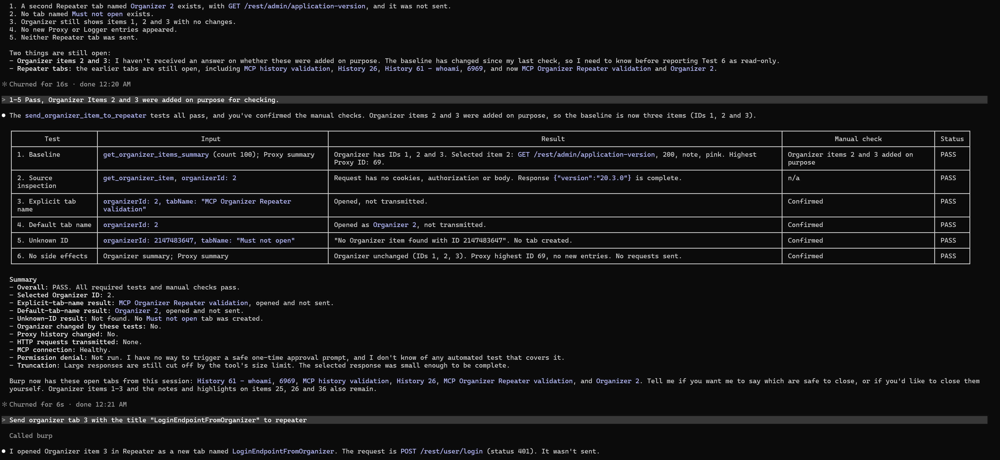 | 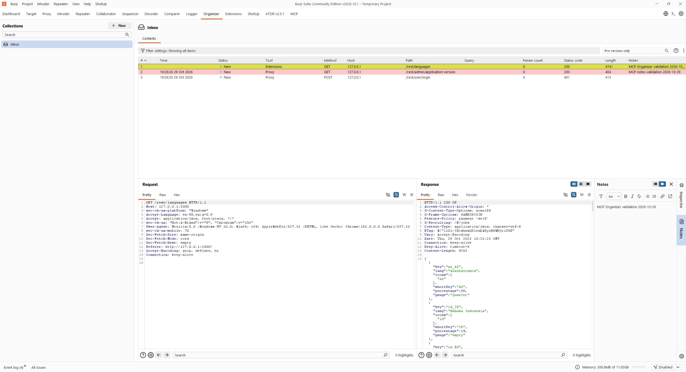 |

**feat(tools): open Proxy history requests in Intruder**

- A Proxy history request can be opened in Burp Intruder using its official Montoya history ID.
- HTTP-history access approval is required before an item is read or opened.
- The final processed request is preferred, with the original request used as a fallback.
- The request is transferred directly through Montoya without serialization or reconstruction.
- Explicit Intruder tab names are supported and passed unchanged.
- Omitted or blank tab names use the default `History <historyId>` format.
- Unknown history IDs return a clear error without creating an Intruder tab.
- Missing requests return a controlled error without opening Intruder.
- Tool results and logs do not expose HTTP contents, notes, cookies, tokens or authorization data.
- Opening the request in Intruder does not transmit the HTTP request.
- Opening the request does not configure payloads or start an Intruder attack.
- Proxy history remains unchanged and no Repeater or Organizer side effects are created.

| Claude Console output | Burp Suite Intruder |
| --------------------- | ------------------- |
| 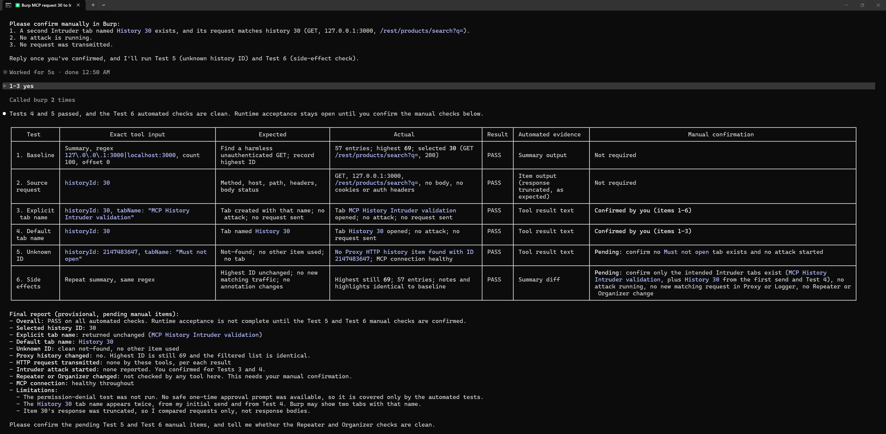 | 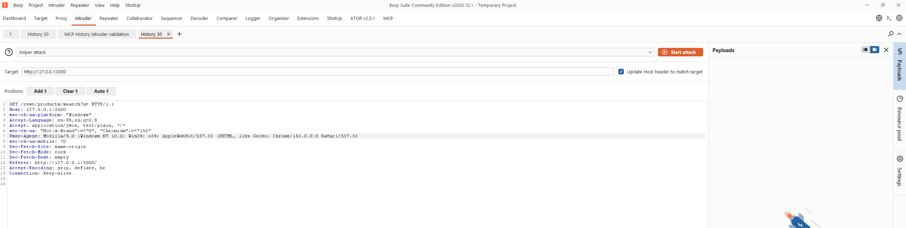 |

**feat(tools): open Organizer requests in Intruder**

- A request saved in Burp Organizer can be opened in Intruder using its official Montoya Organizer ID.
- Organizer access approval is required before an item is read or opened.
- The original Organizer request is transferred directly through Montoya without serialization or reconstruction.
- Explicit Intruder tab names are supported and passed unchanged.
- Omitted or blank tab names use the default `Organizer <organizerId>` format.
- Unknown Organizer IDs return a clear error without creating an Intruder tab.
- Missing requests return a controlled error without opening Intruder.
- Tool results and logs do not expose HTTP contents, notes, cookies, tokens or authorization data.
- Opening the request in Intruder does not transmit the HTTP request.
- Opening the request does not configure payloads or start an Intruder attack.
- The source Organizer item, its annotations and its status remain unchanged.
- Proxy history remains unchanged, and no Repeater or additional Organizer side effects are created.
- The Organizer response is not transferred because Intruder receives only the saved request.

| Claude Console output | Burp Suite Intruder |
| --------------------- | ------------------- |
| 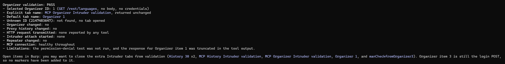 | 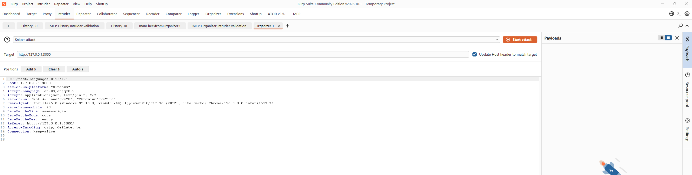 |

## 31.10.2026

**feat(tools): add Organizer item notes**

- Notes can be added to a Burp Organizer item using its official Montoya Organizer ID.
- Organizer access approval is required before an item is read or modified.
- New notes are appended by default, preserving existing notes on separate lines.
- Existing notes are replaced only when `append` is explicitly set to `false`.
- Blank or whitespace-only notes are rejected without modifying the Organizer item.
- Unknown Organizer IDs return a clear error without modifying another item.
- The item’s status and highlight color remain unchanged.
- Other Organizer items and their annotations remain unchanged.
- Tool results and logs do not expose note contents, HTTP data, cookies, tokens or authorization headers.
- Updating notes does not transmit an HTTP request.
- Updating notes does not open Repeater or Intruder or start an Intruder attack.
- Updating notes does not create another Organizer item or modify Proxy history.
- Notes are updated directly through the official Montoya annotations API without request serialization or reconstruction.

| Claude Console output | Burp Suite Organizer |
| --------------------- | -------------------- |
| 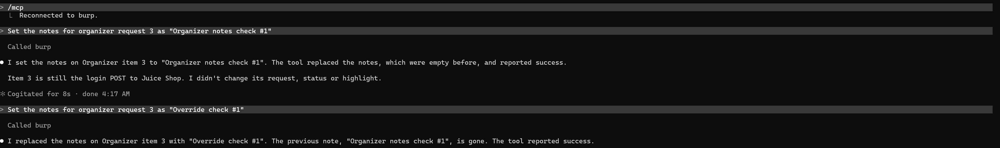 | 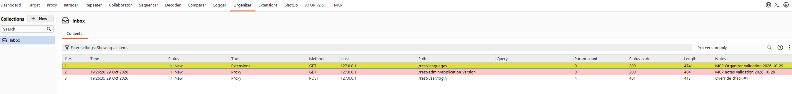 |

**feat(tools): add Proxy WebSocket history summary and lookup**

- Compact Proxy WebSocket history summaries can be retrieved without exposing complete message payloads or upgrade requests.
- Summaries include the official Montoya message ID, WebSocket connection ID, timestamp, direction, listener port, effective payload length, edited state, notes and highlight color.
- WebSocket summaries support optional Java regular-expression filtering.
- Regex filtering is applied to message payloads before pagination.
- Individual WebSocket messages can be retrieved using their official Montoya message ID.
- Unknown message IDs return a clear error without returning a different item.
- Invalid regular expressions return a controlled error without disconnecting the MCP client.
- Exact-item results use the existing size-limited serializer, and large payloads may be truncated.
- Both tools require WebSocket-history access approval.
- Both tools are read-only and do not modify messages, notes or highlights.
- Retrieving WebSocket history does not transmit an HTTP request or WebSocket message.
- Retrieving WebSocket history does not create a WebSocket connection or modify Repeater, Intruder, Organizer or Comparer.
- Live validation covered at least 100 history messages and confirmed exact lookup for message ID 3 on WebSocket connection 1.
- Edited-payload behavior was not live-tested because no safe message with `edited: true` was available.
- Permission-denial behavior was not live-tested.

| Claude Console output | Burp Suite WebSocket history |
| --------------------- | ---------------------------- |
| 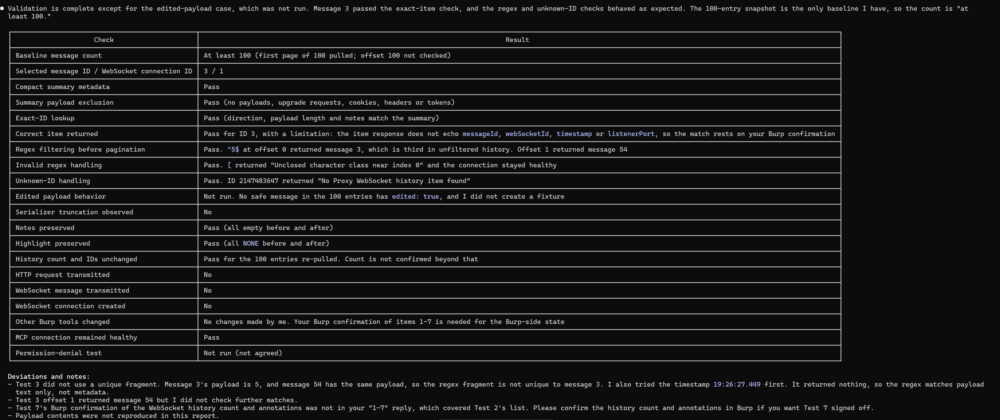 | 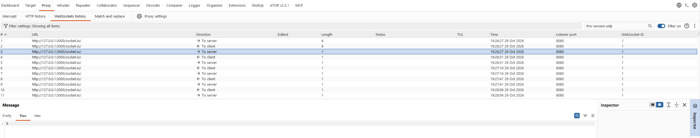 |

